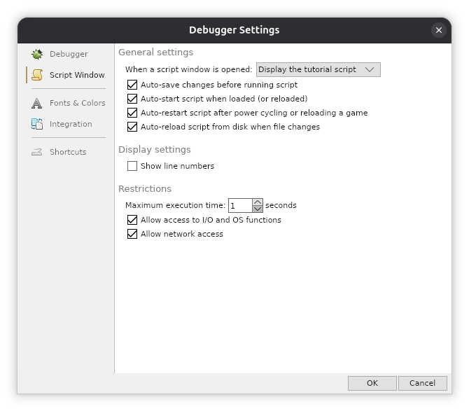
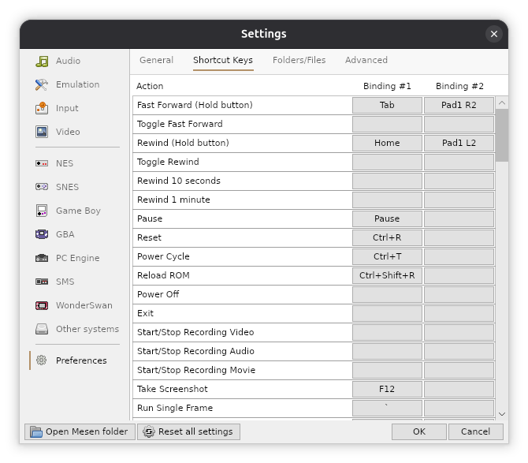

# Mesen scripts for Final Fantasy 1 (NES, USA)

Lua scripts for the Mesen emulator that capture and rewrite the NPC dialogues of Final Fantasy 1 using a local LLM backend. Each NPC gets a personality prompt, the original line is sent to the LLM, and the answer is drawn back into the game's dialog box as in-game text. You can also chat with the NPCs.

## Video

Demo: [Watch on YouTube](https://www.youtube.com/watch?v=1IbaTXgvR_4)

### Chat with the NPCs

Beyond rewriting the original line, you can open a chat box and talk to the NPC. Your message is sent to the LLM with the NPC prompt and the chat prompt (`chat` in `prompts.lua`), and the answer is shown in the dialog box.

* `ESC` closes the chat box
* `Backspace` erases text in the entry

Both keys clash with default Mesen shortcuts, see `Rebind the Mesen shortcuts`.

## Setup

### 1. Install Mesen

Use [Mesen CE](https://github.com/nesdev-org/MesenCE). You also need a Final Fantasy (USA) ROM.

### 2. Allow I/O and network access

The script reads `prompts.lua` from disk and talks to a local LLM, so it needs I/O and network access. In Mesen:

Script > Settings > Script Window > Restrictions

* Allow access to I/O and OS functions
* Allow network access

### 3. Rebind the Mesen shortcuts

`ESC` closes the chat box and `Backspace` is used while typing, but Mesen uses them for Pause and Rewind by default. Rebind both Mesen shortcuts to other keys so they do not trigger while you chat.

### 4. Set up the LLM

See [llm_setup.md](llm_setup.md) for a short guide to running the LLM locally.

### 5. Run

Run from the repository root, passing the script after the path to your ROM:

    Mesen "/path/to/Final_Fantasy_(USA).zip" run.lua

## Configuration

`prompts.lua` is a Lua file returning a table:

    return {
      -- Sent every time, before the character prompt and the original text
      general = [[You are an NPC in the NES game Final Fantasy 1. ...]],

      -- npcs[map id][character id] = "character prompt"
      npcs = {
        [0x00] = {
          [0x50] = "A citizen of Coneria, proud of the town and cheerful.",
        },
      },
    }

Map and character IDs are the ones printed in the console (`KEY: 00:50` is map `0x00`, character `0x50`). Talk to an NPC to find its IDs.

## Notes and limitations

The quality of the dialogues depends entirely on the LLM and on your configuration. This is experimental: the output is not always accurate, and it can occasionally break the game.

Gemma 4 already knows part of the FF1 lore without any extra prompt, but giving it more context improves the results. For example, a prompt describing the current location, or more detail about each NPC, makes the dialogues more consistent.

### Ideas

The LLM could do more than talk. Since the script runs inside the emulator, an NPC could trigger Lua code too give or take money and items or even advance the story !